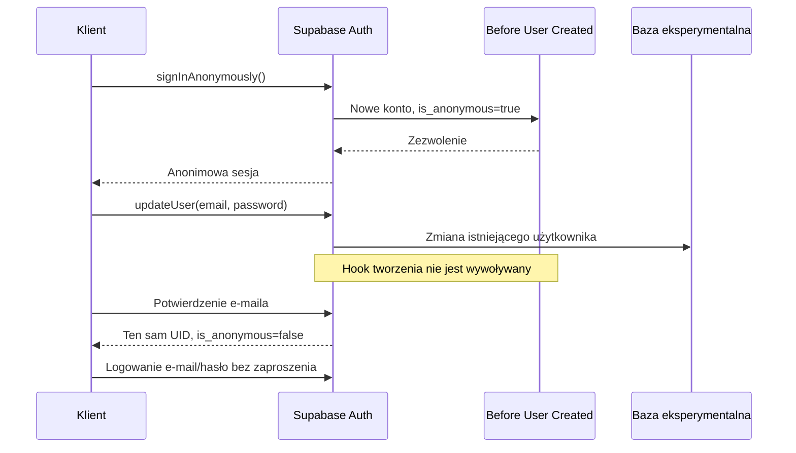

# Anonymous Auth: lokalny PoC bezpieczeństwa 1.4.0

**Rekomendacja: nie wdrażać badanego wariantu na staging ani produkcję.**
Before User Created Hook może zamknąć nieautoryzowane tworzenie kont, ale nie
kontroluje konwersji istniejącego anonimowego użytkownika. W lokalnym PoC
potwierdzono dodanie e-maila i hasła, potwierdzenie adresu oraz logowanie hasłem
bez zaproszenia, z tym samym `user_id`. Obecne RPC dopuszczają także tworzenie
grup przez anonimowe konto. To blokery bezpieczeństwa, nie brakujące elementy UX.

## Zakres i powtarzalność

Badanie z 18 października 2026. Auth **v2.197.0**, zgodny z wcześniej odczytaną
wersją stagingu; obraz przypięty digestem. PostgreSQL 15.8 i obecny PostgREST.
[Runner, SQL hooka i testy](../../../apps/web-svelte/experiments/anonymous-auth/README.md)
tworzą osobną, jednorazową bazę i kontenery. Normalna lokalna baza nie otrzymuje
hooka ani zmiany ustawień. Nie kopiujemy danych finansowych, użytkowników,
sekretów Vault ani harmonogramów. Nie zmieniono stagingu ani produkcji.

W kopii eksperymentalnej globalny signup i Anonymous Auth są włączone; wymagane
jest potwierdzenie e-maila, a ręczne łączenie tożsamości pozostaje wyłączone.
Pierwsze utworzenie anonimowego użytkownika wykazało niezgodność z
`profiles.email NOT NULL`. Dopiero lokalna zmiana tej kolumny na nullable pozwoliła
kontynuować. To wskazuje dodatkową pracę nad profilem, a nie gotowość całej aplikacji
na brak adresu e-mail.

Końcowy zestaw obejmuje 20 testów integracyjnych i kontraktowych. Nie wszystkie
asercje oznaczają działające zabezpieczenie: testy luk świadomie potwierdzają
niepożądane zachowanie. Nie traktujemy zielonego wyniku suite jako akceptacji
architektury.

## Macierz wyników

**Działa** oznacza potwierdzoną kontrolę w opisanym zakresie. **Luka/ograniczenie**
blokuje akceptację albo wymaga projektu. **Niezweryfikowane** nie oznacza sukcesu.

| Scenariusz | Wynik | Dowód i granica wniosku |
| --- | --- | --- |
| Anonimowe tworzenie konta | Działa po lokalnej zmianie profilu | Rzeczywisty GoTrue wydaje sesję z `role=authenticated` i `is_anonymous=true`; profil wymaga obsługi braku e-maila |
| Publiczne e-mail/hasło | Działa | Odmowa i brak nowego Auth UID, także przy spreparowanych metadanych i polach `is_anonymous`, `provider`, `app_metadata`, `role` |
| Sam zgodny adres oczekującego zaproszenia | Działa | Nie wystarcza do publicznego `signUp`; wymagana osobna, tajna autoryzacja serwera |
| OTP tworzące nowe konto | Działa | Odmowa bez nowego UID |
| Bezpośrednie `/invite`, `/admin/users`, `/admin/generate_link` bez uprawnienia serwera | Działa | Odrzucane rzeczywistym API Auth |
| Prosty hook dopuszczający wyłącznie anonimowych | Luka zgodności | Blokuje także obecne serwerowe `generateLink(type: invite)` dla nowej osoby |
| Zweryfikowane zaproszenie z jednorazowym upoważnieniem serwera | Działa w adapterze PoC | Istniejący handler najpierw sprawdza token i odbiorcę; zły odbiorca nie dostaje upoważnienia; link → weryfikacja → profil/hasło → osobny autoryzowany claim |
| Nieznane, wygasłe lub zużyte upoważnienie; inny adres | Działa | Brak utworzonego konta; losowe metadane nie zastępują tajnego upoważnienia |
| Cofnięte, wygasłe lub zmienione zaproszenie przed hookiem | Działa | Hook sprawdza aktualny rekord zaproszenia i odmawia mimo niewygasłego upoważnienia |
| Osiem równoległych żądań z jednym upoważnieniem | Działa | Jeden nowy Auth UID, jedno zużycie; zapisany UID upoważnienia odpowiada utworzonemu użytkownikowi |
| Awaria pomiędzy zużyciem a insertem Auth | Działa w określonym modelu ponowienia | Wymuszony błąd triggera: nie ma użytkownika, stare upoważnienie pozostaje zużyte; nowe dla tego samego ważnego zaproszenia umożliwia ponowienie |
| Błąd SQL, brak konfiguracji, brak EXECUTE, niepoprawna odpowiedź, długie wykonanie hooka | Działa w testowanych awariach | Odmowa i brak nowego użytkownika; długie wykonanie kończyło się `context deadline exceeded` po około 10 s, nie po zakładanych 2 s |
| Dostęp klienta do hooka i tabeli upoważnień | Działa | Prywatny schemat, brak USAGE/EXECUTE dla `anon` i `authenticated`; próby Data API odrzucone |
| Nowe konto Google | Niezweryfikowane rzeczywistym OAuth | Prawdziwa funkcja SQL odrzuca kontrakt payloadu `provider=google`, także ze spreparowanymi metadanymi; nie wykonano wymiany kodu/tokenów Google |
| Istniejące konto Google + hasło | Działa dla syntetycznej tożsamości | Ten sam UID i Google provider ID po dodaniu hasła; nie jest to prawdziwe logowanie przez Google |
| Logowanie hasłem, refresh i recovery istniejącego konta przy awarii hooka | Działa lokalnie | Celowo błędny hook nie blokuje tych operacji; po recovery oryginalna syntetyczna tożsamość Google pozostaje |
| Prywatne transakcje i saldo dwóch anonimowych UID | Działa w sprawdzonych operacjach | Własny zapis/odczyt; obce odczyty puste, podmiana właściciela odrzucona |
| Produkcyjny `commit_import_session` | Działa w teście API | Anonimowy właściciel zapisuje import do Historii; drugi UID nie może zatwierdzić ani odczytać jego operacji; to nie test całego interfejsu importera |
| Nadanie roli admina | Działa | `is_admin=false`; RPC i bezpośrednia podmiana `profiles.role` odrzucone |
| Grupy i serwerowe przygotowanie zaproszenia | Luka | Anonimowy tworzy grupę; uprawniony serwerowy RPC akceptuje tego właściciela jako aktora wysyłki. Edge nadal wymaga osobnej blokady demo; eksperyment nie wysyła rzeczywistych zewnętrznych wiadomości |
| Claim zaproszenia przez anonimową sesję z fałszywym e-mailem w metadanych | Działa w tej próbie | Odmowa i brak członkostwa |
| Dodanie e-maila i hasła do istniejącego anonimowego konta | **Potwierdzona luka** | Weryfikacja e-maila i późniejsze logowanie hasłem kończą konwersję: ten sam UID, `is_anonymous=false`, bez zaproszenia i bez wywołania hooka tworzenia |
| Ręczne dodanie Google do anonimowej sesji | Działa tylko obecna blokada konfiguracji | API odmawia z `manual_linking_disabled`; ścieżki po włączeniu linking i rzeczywistego Google OAuth nie uznajemy za sprawdzone |
| Fizyczny Android, cold/warm deep link z prawdziwej poczty, prawdziwy Google OAuth | Niezweryfikowane | Brak podłączonego urządzenia/ADB i uwierzytelnionej interakcji Google w tym środowisku; mocki i widok mobilny nie zastępują tych dowodów |

Nie wykonano pełnych 78 funkcji jako anonimowy użytkownik. Próby obejmują istotne
prywatne finanse, import, uprawnienia administracyjne i grupy; wcześniejszy audyt
katalogu nadal obowiązuje. Limity, CAPTCHA, retencja, utrata tokenów i przełączanie
real/demo pozostają przedmiotem projektu, nie są zaimplementowane tym PoC.

## Atomowość i granice upoważnienia

Eksperymentalny rekord zawiera hash losowych 256 bitów, ID zaproszenia, adres,
operację `create_invited_user`, termin, czas zużycia i wygenerowany UID. Klient nie
może utworzyć ani odczytać takiego rekordu. Adapter wydaje go dopiero po istniejącej
serwerowej weryfikacji tokenu i odbiorcy. Hook korzysta z autorytatywnego
`user.is_anonymous` i `app_metadata.provider` przekazanych przez GoTrue, a nie z ich
kopii w edytowalnym `user_metadata`.

Zużycie to warunkowy `UPDATE ... WHERE consumed_at IS NULL ... RETURNING`, z
ponowną kontrolą aktualnego zaproszenia i adresu. Nie jest oparte na samym adresie
ani fladze metadanych. Nonce w metadanych jest tajnym nośnikiem dowodu, którego hash
musi istnieć po stronie serwera; po użyciu ten nośnik nie daje już uprawnień.

**Nie jest to jedna transakcja obejmująca hook i Auth INSERT.** Wersja Auth
wywołuje Before User Created poza transakcją tworzenia użytkownika. Po błędzie
insertu nie przywracamy starego upoważnienia. Test dowodzi bezpiecznego ponowienia
ze świeżym upoważnieniem, ale produkcja potrzebowałaby kontrolowanego wydawania,
limitu ponowień i uzgadniania niepewnego wyniku. Cofnięcie zaproszenia między
zakończeniem hooka a insertem również nie jest atomowo związane z tym insertem;
późniejszy claim musi ponownie odrzucić cofnięte zaproszenie.

Hook nie otrzymuje wiarygodnej nazwy oryginalnego endpointu ani informacji
„to żądanie Admin invite”. Powiązanie z operacją jest więc kontraktem upoważnienia
i zaufanego wydawcy, nie rozpoznaniem `/invite` kontra `/signup` po adresie czy
metadanych. To istotne ograniczenie przy wymaganiu ścisłego powiązania z operacją.
Nie wdrożono serwera wydającego sesje przez service-role.

## Dlaczego sam hook nie chroni przed konwersją

Publiczny signup jest technicznie otwarty, a anonimowe konto już istnieje. Sama
polityka tworzenia nowych użytkowników nie ogranicza dodawania metod logowania,
email-change, identity linking ani uprawnień społecznościowych. Dodanie hasła nie
może zmienić demonstracyjnych finansów w rzeczywisty profil tej samej tożsamości.

## Porównanie kosztów i rekomendacja

Rozmiary są oceną prac i ryzyka, nie kalendarzem ani wyceną abonamentu.

| Wariant | Dodatkowa praca | Koszt i decyzja |
| --- | --- | --- |
| Jeden projekt, tylko Before User Created | Hook i konfiguracja | Mało kodu, ale potwierdzona konwersja bez zaproszenia i otwarte grupy. **Odrzucony do wdrożenia** |
| Jeden projekt, trwałe uprawnienie `demo`/`real` (nie tylko `is_anonymous`) | Trusted registry po stronie serwera; blokady konwersji Auth; audyt RLS/RPC/SECURITY DEFINER/Edge (grupy, zaproszenia); dostosowanie profilu i limitów | L, istotna ingerencja w Auth. **Docelowy wariant bez trzeciego projektu** — tylko po przejściu negatywnych testów bezpieczeństwa. Ten PoC go nie udowodnił. |
| Osobny trzeci projekt Supabase demo | Osobna Auth, klucze, sesje, pipeline migracji, limity | Dodatkowa opłata (Free limituje 2 aktywne projekty). **Odrzucony kosztowo** przy obecnej skali; zachowujemy tylko `portfelik-prod` i `portfelik-staging`. |
| Staging jako stałe publiczne demo | Minimalny kod | **Odrzucony jako usługa publiczna** (migracje/reset/testy niszczą postęp). Staging może służyć wyłącznie do budowy i kontrolowanych kont testowych. |

**Decyzja B0 (aktualizacja właściciela, 2026-10-18):** zero dodatkowego kosztu
infrastruktury. Publiczne Anonymous Auth w 1.4.0 jest **NO-GO**, dopóki wspólny
projekt z trwałym claimem `demo`/`real` nie przejdzie audytu. Awaryjnie 1.4.0 może
wydawać kontrolowane konta testowe na stagingu, bez otwierania publicznego signup
ani Anonymous Auth na produkcji.

Nie dokładamy teraz kolejnych wyjątków w Auth ani prowizorycznego brokera sesji.
Nie tworzymy trzeciego projektu, nie włączamy Anonymous Auth na stagingu/produkcji
i nie uruchamiamy resetu. Kierunek uproszczenia starego demo pozostaje; obecna
redukcja starego subsystemu wynosi 0%, ponieważ jego zamiennik nie został
zatwierdzony. Kod eksperymentu jest narzędziem dowodowym i nie wchodzi do aplikacji.

## Źródła

- [Supabase: Before User Created Hook](https://supabase.com/docs/guides/auth/auth-hooks/before-user-created-hook)
- [Supabase: Anonymous Auth](https://supabase.com/docs/guides/auth/auth-anonymous)
- [Auth v2.197.0: hook poza transakcją i konto zewnętrzne](https://github.com/supabase/auth/blob/v2.197.0/internal/api/hooks.go)
- [Auth v2.197.0: generowanie linków](https://github.com/supabase/auth/blob/v2.197.0/internal/api/mail.go)
- [Auth v2.197.0: aktualizacja istniejącego użytkownika](https://github.com/supabase/auth/blob/v2.197.0/internal/api/user.go)
- [Auth v2.197.0: łączenie tożsamości](https://github.com/supabase/auth/blob/v2.197.0/internal/api/identity.go)

Przejrzano również aktualny indeks zmian Supabase. Wniosek dotyczy sprawdzonego
obrazu i kontraktu hooka; aktualizacja wersji Auth wymaga ponowienia eksperymentu.
