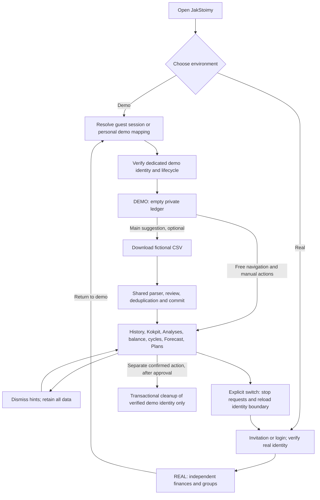

# Demo 2.0: separate identities, shared financial model

**Proposal for approval. No demo Auth configuration, provisioning, switching or
cleanup implementation is authorized by this document.** The earlier workspace
proposal was cost analysis, not a chosen migration. No `demo_workspace_id`
columns are proposed in the financial model.

The subsequent [local hook experiment](anonymous-auth-poc.md) blocks rollout of
the hook-only same-project variant: email/password conversion of an existing
anonymous UID bypasses Before User Created. A dedicated demo project is now the
preferred next architecture study. No staging or production change is approved.

## Product contract

One product and one financial engine serve two independent identities. Demo has
its own CSV imports, history, balance, cycles, forecasts and plans. Real finances,
groups and invitations belong to the real identity. No financial rows change
owner when the user registers, logs in or leaves demo. At most three contextual hints can be dismissed without deleting anything. Demo stays available for exploration
and repeated imports after registration. Navigation and every balance surface
identify it as DEMO.

A registered user should have one stable personal demo identity, available again
after switching to real and, ideally, on another installation. Guest persistence
and registered-account recovery are different requirements; a locally cached
anonymous refresh token alone cannot satisfy the latter.

## Target flow

The identity implementation behind Resolve remains a decision gate. No UI switch
ships before the session boundary and server permissions pass isolation tests.

## Three optional hints and the sample CSV

1. In an empty demo: one suggestion to download and import `jakstoimy-demo.csv`.
2. After a committed import: a small link encouraging the user to open Analyses.
3. On first forecast exploration: suggest confirming the balance and configuring
   recurring salary and obligations. Historical CSV alone is not a future schedule.

No hint blocks navigation, opens a mandatory modal, forces route changes or marks
financial work complete without observing the real operation. Manual transactions
and plans remain available without CSV. Persist only seen/dismissed state for
these three hints on the demo identity; derive import success from import history.
There is no seven-step progress state, spotlight engine or second welcome tour.

The CSV contract is six complete months and about 100 fictional operations;
**96 rows** is the proposed deterministic fixture (16 per month), within the
requested 60–100 operations. Include income,
groceries, housing, installments, subscriptions, transfers and irregular costs.
Use a format already supported by the production importer, preserving separate
description and counterparty columns. Do not add a demo parser. The existing
adapter may map recognized columns automatically; the user still reviews source
fields, categories, exceptions and totals before committing. No background seeding.

A versioned manifest must specify exact row counts, date boundaries, income and
expense totals in grosze, net movement and per-month totals. Historical movement
is not the bank's known balance: test an explicitly confirmed anchor separately.
Repeated import in the same demo verifies duplicate detection; real-account
import independence is tested using a different UID. Keep successful session and
transaction history after application restart. Fixture creation/parser validation
can proceed independently of identity implementation; importing it into a real
user's finances is not part of this work.

## Anonymous Auth compatibility audit

Evidence: current repository source, a local schema updated to committed migrations,
75 public RLS policies and 78 functions executable by `authenticated`. A separate
44-function inventory covers direct financial-table references, including 26
SECURITY DEFINER functions. These numbers are review sets, not mandatory rewrites.
Staging configuration was inspected read-only: `disable_signup=true`, anonymous
sign-ins disabled; GoTrue health reports `v2.197.0`.

| Finding | Severity | Consequence / prerequisite |
| --- | --- | --- |
| GoTrue `SignupAnonymously` rejects `DisableSignup` | P0 compatibility | Enabling only the anonymous provider is insufficient. Changing the global signup policy needs explicit approval and a server-side alternative gate for ordinary signup |
| Anonymous users receive `authenticated`; none of the 75 policies checks `is_anonymous` | P0 enablement gate | Ownership predicates remain valuable, but this role alone grants too many product capabilities. Audit direct policies and all privileged routes |
| `create_group` accepts an authenticated UID; other group RPCs enforce ownership/membership, not demo exclusion | P0 enablement gate | A demo identity could create a group and become its owner unless explicitly denied |
| `send-group-invitation` invite action verifies `getUser` and passes the UID to an owner-authorized service RPC | P0 enablement gate | An anonymous group owner could reach real email delivery. Deny demo actors at Edge and SQL boundaries |
| `handle_new_user`/email-update triggers assume an email; `profiles.email` is NOT NULL | P1 compatibility | Anonymous identity creation must be tested against actual NULL/empty-email behavior and handled deliberately. Do not invent a verified email merely to satisfy the profile schema |
| `enforce_max_user_cap` counts every Auth user, with invitation exemption | P1 availability | Unbounded demo creation can consume the global account allowance. Separate demo quotas and keep real invitation behavior |
| App bootstrap treats every Auth user as a regular authenticated user and calls `autoSubscribePush` | P1 isolation | Add an explicit trusted demo mode; disable external push/prompt behavior for demo |
| `delete_account` transfers shared records to group owners and touches invitation state | P0 cleanup gate | It is not a demo cleanup API. Do not reuse it for reset or abandoned-account cleanup |
| Internal push, role-sync and summary Edge Functions use a server-only trigger secret | Existing protection | Retain that authentication; additionally exclude demo from real delivery, summaries and role elevation |
| Current session cache keys include `user_id`, and layout clears QueryClient when it changes | Useful foundation | Verify pending mutations, module state, storage and native files too; cache clearing alone is insufficient |

The anonymous-signup conflict is verified against the source matching staging's
reported version, not inferred from a dashboard label:
[GoTrue v2.197.0 anonymous.go](https://github.com/supabase/auth/blob/v2.197.0/internal/api/anonymous.go#L18).
The [Supabase anonymous Auth guide](https://supabase.com/docs/guides/auth/auth-anonymous)
also documents `authenticated`, identity linking, lost-session limitations,
CAPTCHA/rate limits and the absence of automatic cleanup.

No anonymous session was created for this audit and no remote Auth setting was
changed. Compatibility findings still require approved local integration tests;
they do not prove a working anonymous demo.

## Can the existing financial path be reused?

Yes in structure, conditionally in operation. The existing parser and financial
calculations do not require an email. `bank-import.ts` authenticates the user and
writes their ID. Accounts, import sessions, provenance and hard duplicate indexes
are already owner-scoped; dependent rows follow their owned parent. A separate
UID gives the same CSV a separate dedup namespace. Fingerprint/reconciliation
helpers must still be tested with two owners and forged foreign session/row IDs.

`save_net_worth_snapshot` obtains `auth.uid()` for private cash/assets. Plan,
transaction and recurrence services already use owned records and protected RPCs.
Kokpit/Analyses/Forecast consume those shared sources. A demo with no groups should
therefore reuse the normal private flows without adding a selector to 102 query
sites or changing financial arithmetic. This is an architectural assessment,
not an end-to-end pass for anonymous users.

Allowed demo capabilities: own private import/review/history, categories/rules,
transactions, balance/assets, recurrence and plans, analysis and forecast.
Denied: group creation/membership/ownership, invitations, admin operations, role
changes, external push delivery, real-account settings and identity conversion.

Use a trusted, server-owned demo registry/marker, never `user_metadata`. For true
anonymous identities, also validate the signed `is_anonymous` claim. A permanent
managed demo has `is_anonymous=false`, so registry membership must be the durable
capability boundary in either implementation. Demo cannot change its login email,
link a real OAuth identity or become a real account. Registration authenticates a
separate real UID. Add SQL guards to social RPCs, direct restrictive policies on
the relevant group/push surfaces, and checks in the Edge invite endpoint. Prevent
membership insertion for a demo target even when performed by a real group owner.
Existing admin role checks remain; demo cannot be a role-assignment target.

## Choosing the identity mechanism

| Option | Signup policy and durability | Change cost / remaining risk |
| --- | --- | --- |
| Anonymous Auth in the current project | Conflicts with global `disable_signup=true` in the inspected Auth version. Resume works while its refresh token survives; there is no normal login by anonymous UID on another device | L: Auth gate redesign, profile compatibility, quotas, permissions and recovery decision. Not a drop-in switch |
| Backend-provisioned identity/session broker | Previously considered for durable recovery | Excluded from implementation by the user; no provisional service-role session issuer |
| Dedicated demo Supabase project | Strong environment isolation; can use independent signup policy and the same schema/app | L/XL operational cost: deployment, secrets, capacity, project lifecycle and drift; no implicit infrastructure authorization |
| Workspace dimension on real identity | Seamless identity, but changes finance scoping itself | XL: review 19 tables, one view, 44 financial functions, 18 services/102 query sites, balance uniqueness and dedup |
| Existing groups | Cannot isolate private imports, categories, assets and dismissals by itself | Does not meet the contract without extending the financial model |

**Current recommendation:** retain separate identities and the shared financial
engine, but do not deploy the tested hook-only variant. The local PoC proves that
creation gating does not prevent anonymous-to-permanent conversion or social
capabilities. Evaluate a dedicated demo project before expanding production Auth
with grant issuance, conversion guards and recovery machinery. The dedicated
project requires explicit approval and must still solve session recovery,
capabilities, quotas and retention. See the result/cost matrix in the PoC report.

A session broker based on Auth Admin link generation was an earlier proposal.
The user explicitly rejected a provisional service-role session issuer; it is
not implemented or recommended as an interim solution. The experiment uses
Admin only for ordinary local fixtures and the existing invitation path.

Attaching a guest demo after real login requires proof of both identities. Link
only the metadata mapping, never financial ownership. A unique mapping enforces
one personal demo per real user. If that real user already has a demo, return to
it; do not merge histories or delete the guest automatically.

## Session boundary, web and Android

Keep real and demo Auth persistence in separate SDK storage namespaces. Do not
call `signInAnonymously`, `linkIdentity` or `updateUser(email)` on the active real
client to enter demo. Do not manually copy refresh tokens into ad-hoc storage.

For this static SvelteKit/Capacitor app, prefer selecting one immutable SDK client
at document bootstrap, then a full reload across the Demo/Real boundary. Existing
services keep importing one `supabase` client per document. Two live clients with
a mutable shared global transport would make in-flight writes harder to reason
about. Preserve the existing real storage key; use a separate opaque demo-instance
key and separate BroadcastChannel identity. A per-tab pointer chooses environment;
any durable mapping is namespaced to the verified real user or guest instance.
Callbacks, invitations and account setup always bootstrap the real Auth context.

Switch sequence:

1. Show a transition screen; disable actions and resolve any in-flight import or
   mutation. Bind mutations to their originating UID; never replay them with a
   newly selected identity. Cancel/await queries and subscriptions.
2. Clear QueryClient and identity state, profile/theme, tour request/progress UI,
   date/scope/filter selections, sheets and native overlay/back handlers. Clear
   retained CSV bytes and local export files. Unmount financial views.
3. Namespace or clear `guided-tour-progress`, `login_redirect_to`, import-reveal,
   analytics-first-import and push preference/cooldown keys. Keep actual auth
   credentials isolated in SDK-managed keys. Do not clear the real session merely
   because a demo hint is dismissed.
4. Persist only the selected environment pointer and reload. Revalidate the
   selected identity with Auth and the trusted registry before rendering finance.
5. Never render a cached real balance while demo boots, or demo balance while real
   boots. Verify cold/warm Android launch, hardware back, process termination,
   browser history and simultaneous tabs.

Auth access-token expiry is not account expiry: let the SDK refresh the selected
session. On refresh failure, block finance and explain session recovery. Do not
silently create a new demo UID. Anonymous credentials lost on reinstall/cleared
storage cannot recover that account; a mapping alone is not an Auth credential.
A managed personal demo can instead be reissued through its verified real owner.

## Lifetime, retention and cleanup proposal

Dismissing hints only persists three simple preferences. Closing an app preserves
its selected session and server data. Registered personal demo history and plans
have no inactivity expiry: keep them until an explicit reset or an approved
account-lifecycle action. This matches the durable-laboratory requirement.

For unlinked guests only, propose 30 days of inactivity plus a 7-day grace period,
disclosed before entry and subject to approval. A server timestamp, not a client
clock or one token's expiry, determines activity. Registered real→demo mappings
exclude those demos from this abandoned-guest rule. CAPTCHA, request/data caps,
per-user uniqueness and global capacity limits control growth. Supabase does not
automatically clean up anonymous accounts.

No cleanup runs before approval. A future cleanup operation must resolve the
candidate exclusively from the trusted registry, verify ownership/type, and lock
its lifecycle. It must preflight that there are no groups, foreign financial
links or real-user references. Do not call the existing real `delete_account`
RPC, which has shared-custody behavior. Do not select accounts merely by an email
prefix, age or `is_anonymous` alone.

Use the existing aggregate FK map to delete only that dedicated demo UID's
records in a single database transaction: notification/dismissal and settlement
links; import links→rows→sessions→accounts; plan snapshots/items/terms→plans;
recurring skips/occurrences→templates; other transactions; private cash/assets/
snapshots; rules→owned categories; profile/Auth identity only when the approved
operation explicitly retires the demo account. Preserve a non-financial lifecycle
tombstone so retries are idempotent. Check every cascade edge rather than adding
a blanket cascade. Any failure rolls back. A racing write must either commit
before cleanup or fail against the retired/deleted owner/parent; no partial reset.
Deletion and session revocation do not instantly invalidate previously issued
JWTs, so prove old tokens cannot recreate finance or reach social/admin paths.

A reset that preserves the demo UID and a retirement that creates a replacement
UID are separate design choices. Neither is selected here. Replacing the UID
must be reconciled transactionally with the one-personal-demo mapping; it cannot
be an implicit consequence of dismissing hints.

## Validation and simplification cost

Required tests include two demo UIDs and a real UID; forged parent IDs; foreign
reads/writes; group/admin/email denial; real/demo import independence and same-demo
reimport dedup; balances/forecast consistency; app restart/resume; switch under
slow requests; expiry/lost refresh; real-user mapping recovery; failure mid-reset;
parallel cleanup/writes; idempotent retry; orphan checks and stale JWTs.

The baseline old demo/onboarding subsystem is **17 production files / 2,151 raw
lines** at `a36a1a5`, excluding shared finance, tests, migrations and translations.
Current removal is **0%** while the replacement is unapproved. The intended
50–75% reduction corresponds to roughly 1,076–1,613 old lines, not a guarantee of
net application shrinkage. Report removed old lines and added identity/security/
retention code separately. Replacing a 205-line seeder and 162-line scenario with
a CSV is useful; adding an unreviewed Auth broker merely to hit that metric is not.

The separate-UID variant avoids a new scope column across financial tables and
leaves the 102 financial query sites structurally unchanged. Expected new state
is one private lifecycle/mapping registry, a capability helper, a guarded session
entry/exit boundary and at most three contextual hints. Anonymous Auth additionally changes profile
compatibility and signup gating; a managed identity additionally needs the broker.
Both still require an audit of existing privileged operations and external side
effects. Remove old seeding, spotlight/chrome/welcome flows and duplicate progress
only after the shared-import replacement passes; keep historical migrations and
all tests protecting financial truth or permissions.
