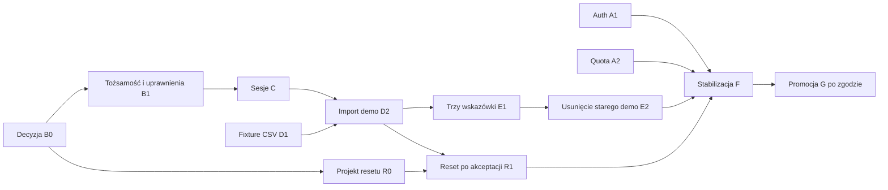

# JakStoimy 1.4.0 — zakres i roadmapa do zatwierdzenia

Dokument projektowy. Zatwierdzony kierunek: osobna tożsamość demo, jeden silnik
finansowy, prawdziwy import i maksymalnie trzy pomijalne wskazówki. Sposób tworzenia,
przechowywania i odzyskiwania tożsamości demo nadal wymaga decyzji. Ten plan nie
zatwierdza Anonymous Auth, resetu, zdalnych migracji ani promocji na `main`.

Projekt techniczny i diagram: [Demo 2.0: separate identities](../architecture/flows/demo-identity.md).

Audyt tekstów i porównanie komunikatów: [Język 1.4.0](jakstoimy-1.4.0-copy-audit.md).

Lokalny eksperyment hooka: [macierz wyników i rekomendacja](../architecture/flows/anonymous-auth-poc.md).
Wariant z samym Before User Created jest zablokowany przez konwersję anonimowego
konta bez zaproszenia. Trzeci płatny projekt Supabase jest odrzucony kosztowo.
B0: publiczne Anonymous Auth = NO-GO w 1.4.0; docelowo wspólny projekt z trwałym
claimem `demo`/`real` po audycie; awaryjnie kontrolowane konta testowe na stagingu.

## Zamrożony zakres

- Auth i zaproszenia: Google, e-mail/hasło, profil, reset hasła, web/Android,
  nowe i istniejące konta; publiczny sign-up pozostaje wyłączony.
- Wejście: „Wypróbuj konto demo” / „Zaloguj się”. Normalna aplikacja z oznaczeniem
  DEMO przy saldzie i w nawigacji; osobne tożsamości i dane rzeczywiste/demo.
- Indywidualne demo dostępne przed i po rejestracji, z trwałą historią i planami.
  Przejście na konto rzeczywiste nie przenosi fikcyjnych operacji.
- `jakstoimy-demo.csv`: sześć miesięcy, 60–100 operacji (propozycja: 96), dokładne sumy kontrolne.
  Użytkownik pobiera plik i sam zatwierdza import w istniejącym importerze.
- Trzy nieblokujące wskazówki: import CSV; Analizy po imporcie; saldo/cykle przy
  prognozie. Pominięcie wskazówek ani zamknięcie aplikacji nie usuwa danych.
- Historia, Kokpit, Analizy, saldo, cykle, Prognoza i Plany używają obecnych serwisów.
- Jawny, bezpieczny reset po osobnym zatwierdzeniu projektu i testów awarii.
- Usunięcie zastąpionego seedera i toura; pomiar redukcji starego subsystemu.

Poza wydaniem: „Co jeśli?”, publiczne read-only, otwarta rejestracja, przenoszenie
historii demo na konto rzeczywiste, rozbudowany tour engine i obowiązkowy kreator.
Slogan pozostaje późniejszą decyzją, bez zmian marketingowych w tych PR-ach.

## Roadmapa małych PR-ów

S/M/L/XL określa złożoność i ryzyko integracji, nie czas kalendarzowy. L oznacza
pracę przez kilka granic systemu; XL wymaga ponownego ograniczenia zakresu.
Oznaczenia poniżej są planowanymi PR-ami, nie numerami utworzonych PR-ów GitHub.

| PR | Zakres | Zależności | Rozmiar | Główne ryzyko | Kryterium zakończenia |
| --- | --- | --- | --- | --- | --- |
| A1 | Auth z zaproszeń: e-mail/hasło, nazwa profilu, istniejące Google, recovery, wspólny callback i natywne deep linki | Brak zależności od demo | L | Duplikacja konta, przejęcie sesji, członkostwo przed autoryzacją | Ten sam UID/profil/tożsamość Google po dodaniu hasła; osobny claim; wygasłe/cofnięte linki odrzucane; callback i recovery web/Android; publiczny sign-up zamknięty |
| W | Audyt języka i teksty nowych procesów przez Paraglide | Auth teraz; demo/import wraz z B1/C/D2/E1 | M | Obietnice izolacji lub sukcesu przed ich implementacją | Stare/nowe komunikaty w PR; testy błędów i sukcesów; maksymalnie trzy wskazówki; bez globalnego przepisywania tekstów |
| A2 | Atomowy limit prób dostępu do zaproszenia | Istniejący handler; niezależny od A1 UI | S | Równoległe żądania omijają quota | 12 równoległych prób → maksymalnie 5 dopuszczonych, jednakowa odmowa i brak wycieku kluczy |
| B0 | Decyzja o tożsamości demo i przegląd zagrożeń, bez migracji wdrożeniowych | Audyt źródła i Auth | M | Globalne `disable_signup` blokuje Anonymous Auth; anonimowa sesja nie zapewnia odzyskiwania na innym urządzeniu | Wybrany mechanizm, trwałość gość/użytkownik, granice sesji, limity, retencja i wymagane uprawnienia zatwierdzone przez użytkownika |
| B1 | Kontrolowane tworzenie tożsamości i zabezpieczenia RLS/RPC/Edge/triggerów | B0 + bramka A | L | Demo tworzy grupy, wysyła zaproszenia albo zmienia typ konta | Własne prywatne finanse działają; cudze UID, grupy, role i zewnętrzna wysyłka są blokowane również bez UI; jeden osobisty rekord demo; idempotentne provisionowanie |
| C | Zachowanie/odzyskanie sesji oraz wejście i powrót Demo/Real | B1 + zatwierdzony projekt bramki B | L | Stare salda, mutacje i pliki po zmianie tożsamości; nadpisanie realnej sesji | Rozdzielone magazyny Auth, restart z tym samym demo, bezpieczna obsługa utraconego refresh tokenu, czyste cache/store/overlay/pliki, testy wielu kart i Androida |
| D1 | Fikcyjny CSV i manifest oczekiwanych wyników | Brak zależności od B/C | S | Niedeterministyczne daty/sumy, nieobsługiwany format | Sześć miesięcy, 60–100 wierszy; produkcyjny parser; kwoty, zakresy i per-miesięczne sumy sprawdzone bez zapisu na prawdziwym koncie |
| D2 | Pobranie i rzeczywisty import w demo | B1, C, D1 | M | Powtórny import lub ostrzeżenia porównują różne UID | Pełny podgląd/mapowanie adaptera/kategorie/commit; trwała Historia importów i transakcji; powtórny plik bez nowych duplikatów; inny UID ma niezależny import |
| E1 | Oznaczenie DEMO i maksymalnie trzy kontekstowe wskazówki | C, D2 | M | Powrót do obowiązkowego toura lub pozornego zakończenia importu | Cała dozwolona aplikacja dostępna od razu; wskazówki pomijalne; nawigacja nie jest wymuszana; żadne pominięcie nie usuwa finansów |
| E2 | Usunięcie zastąpionego seedera, toura i dublowanego stanu | E1 + scenariusz A poniżej | M | Usunięcie działających zabezpieczeń lub wspólnych serwisów | Jedna ścieżka demo; brak martwych importów/eksportów; testy zachowania zastępują testy seedera; raport LOC i plików przed/po |
| R0 | Przegląd projektu resetu i retencji, bez uruchamiania usuwania | B0/B1; może powstawać równolegle z C/D1 | M | Zwykłe konto lub współdzielone dane trafiają do cleanup | Dokładna lista rekordów i kolejność, autoryzacja rejestru demo, blokady, rollback, replay, JWT i harmonogram zatwierdzone przez użytkownika |
| R1 | Reset i sprzątanie porzuconych gości | R0 zatwierdzony, B1, C, D2 | L | Częściowy reset, równoległe importy, osierocone rekordy | Scenariusz B poniżej; kontrolowany dry-run kandydatów retencji; brak usuwania osobistego demo przez bezczynność; zakończenie wskazówek nie wywołuje cleanup |
| F | Stabilizacja wydania: staging, poczta, bezpieczeństwo, fizyczny Android | A1/A2/B1/C/D2/E1/E2/R1 | L | Mocki zastępują realne OAuth, dostarczenie wiadomości lub test urządzenia | Wszystkie bramki repo, testy prawdziwego przepływu i urządzenia; brak regresji finansów, izolacji i dostępu |
| G | Promocja 1.4.0 i synchronizacja `dev` | F + jawna zgoda użytkownika | S | Przedwczesne włączenie publicznych funkcji lub migracji | Review końcowego diffu/konfiguracji, checklista operacyjna, zatwierdzona promocja i weryfikacja po wdrożeniu |

Jeśli B0/B1 lub C wymaga XL, nie dokładamy ogólnego menedżera kont ani wymiaru
workspace do wszystkich finansów. Wracamy z konkretnym ograniczeniem albo wariantem
izolacji do decyzji użytkownika. Nie zastępujemy niezakończonego demo atrapą.

## Zależności i prace równoległe

Równolegle mogą powstawać A1/A2, analiza B0, fixture D1 i projekt testów. Po decyzji
B0 projekt retencji/resetu R0 może toczyć się obok sesji C. Integracja importerów D2
czeka na rzeczywistą izolację tożsamości. Usuwanie starego demo E2 czeka na działający
zamiennik. To opis niezależności prac, nie polecenie uruchamiania dodatkowych agentów.

## Trzy bramki bezpieczeństwa

**A — utworzenie demo:** rozstrzygnięty konflikt Anonymous Auth / globalny zakaz
signup; profile i limity zgodne z wybranym typem; kompletna macierz RLS/RPC/Edge;
CAPTCHA i quota; brak możliwości zamiany demo w realne konto lub nadania mu grup.

**B — zmiana środowiska:** niezmienne przypisanie żądania do UID, dwa magazyny
sesji, jednoznaczny bootstrap i opróżnienie pamięci/plików. Zero choćby przejściowego
renderowania fikcyjnego salda w realnym kontekście. Odtworzenie na Androidzie
sprawdzone po zamknięciu procesu, nie tylko po odświeżeniu przeglądarki.

**C — usuwanie:** jawna akceptacja projektu, trusted registry i własność, kompletna
transakcja, test wymuszonej awarii, blokady konkurencji, idempotencja i test starych
JWT. Dopóki ta bramka nie przejdzie, nie udostępniamy aktywnego przycisku resetu
ani harmonogramu kasowania. Pomijanie wskazówek pozostaje niezależne od retencji.

## Dwa scenariusze krytyczne i regresje

**A — prawdziwe użycie i trwałość:** pobranie CSV → istniejący parser/review/commit
→ Historia → Analizy → potwierdzenie salda/cykle → Prognoza i plan. Sprawdzamy liczbę
operacji, wpływy, wydatki, kotwicę salda, źródła prognozy i proweniencję importu.
Zamykamy aplikację, wracamy do tego samego demo, pomijamy wskazówki, ponawiamy import.
Dane i postęp są zachowane; ponowny plik nie tworzy kolejnych operacji.

**B — reset i rollback po zatwierdzeniu:** dwa demo UID oraz realny UID z finansami
i grupami; import i dodatkowe ręczne transakcje, cykle, saldo, reguły, kategorie,
plany i rozliczenia. Wymuszamy błąd po początkowych usunięciach: żaden rekord nie
znika częściowo. Powtarzamy reset i równoległy commit/import/materializację cyklu.
Po sukcesie nie ma osieroconych danych ani zmian w cudzych rekordach, prawdziwych
finansach lub uprawnieniach. Stary token nie odtwarza wycofanego środowiska.

Dodatkowe regresje: istniejąca tożsamość Google zachowuje ten sam `user_id` i profil
po dodaniu hasła; link po wygaśnięciu/cofnięciu nie nadaje członkostwa; prawdziwa
poczta, callbacki, nowe i istniejące konta, recovery i hardware back na Androidzie.

## Budżet uproszczenia

Punkt odniesienia: 17 plików produkcyjnego demo/onboardingu, 2 151 surowych linii
w bazowym `a36a1a5`. Cel kierunkowy 50–75% dotyczy tego subsystemu, nie repozytorium.
Raport E2 osobno poda pliki/linie usunięte, nowy kod demo, nowy kod uprawnień/sesji/
retencji i wynik netto. Nie zalicza przeniesienia starych helperów do innych katalogów
jako redukcji. Nie usuwamy historycznych migracji ani testów prawdziwych finansów.

Dla wariantu osobnego UID zakładamy zero nowego wymiaru workspace w 102 miejscach
zapytań i zero drugiego silnika finansowego. Nadal płacimy za audyt 75 polityk,
78 dostępnych funkcji i zewnętrznych efektów ubocznych. Oszczędności muszą wynikać
z usunięcia toura/seedera, a nie z pominięcia kontroli bezpieczeństwa.
